# Skeletyl – ZMK config

ZMK config for my Bastard Keyboards Skeletyl (36 keys, wireless, two nice!nano v2).
The firmware is built with the stock **Corne** shield (`corne_left` / `corne_right`).
The Skeletyl just doesn't have the Corne's outer columns, which is why those
positions are `&none` in `config/corne.keymap`. The layers mirror my
[Ferris Sweep QMK keymap](https://github.com/theodorosidmar/ferris-sweep-qmk).

| Path | What |
| --- | --- |
| `config/corne.keymap` | The keymap |
| `config/corne.conf` | Firmware options (mouse keys enabled) |
| `config/west.yml` | ZMK version (`v0.2`) |
| `scripts/build.sh` | Builds the firmware locally with Docker |
| `scripts/flash.sh` | Builds, then flashes it to the keyboard |
| `scripts/draw.sh` | Regenerates `img/` |
| `scripts/keymap_drawer.yaml` | Key labels used by `draw.sh` |
| `img/` | Layer images (generated) |
| `.github/workflows/build.yml`, `build.yaml` | The same build on GitHub for every push (a check, and a fallback) |

## Flashing

The firmware builds on this machine, in the same Docker image GitHub Actions
uses. You don't need to commit or push: the build uses whatever is in `config/`
right now.

```sh
scripts/flash.sh          # build + flash the left half. Enough for keymap changes
scripts/flash.sh both     # both halves
scripts/flash.sh right    # right half only
scripts/build.sh          # only build, into firmware/ (gitignored)
```

`flash.sh` builds, then for each half:

1. Asks you to plug it in via USB and **double-tap its reset button**. The
   nice!nano then shows up as a USB drive called `NICENANO`.
2. Mounts the drive (`udisksctl`), copies the `.uf2` file, and waits for the
   board to reboot.

Build times: the first build downloads ~4.6 GB (2.3 GB Docker image, 2.3 GB of
ZMK/Zephyr sources in `~/.cache/zmk-workspace`) and takes a few minutes. After
that, a build takes ~5–15 seconds. The sources are downloaded again only when
`config/west.yml` changes. `~/.cache/zmk-workspace` can be deleted anytime;
the next build recreates it. If a build fails in a strange way after editing
the scripts, delete `~/.cache/zmk-workspace/build` (the cached build folders).

Requirements: `docker` (usable without sudo) and `udisks2`.

### Do I need to flash both halves?

Usually not. The **left half is the central**: it holds the keymap and talks to
the computer. The right half only sends key presses to the left. So:

- **Keymap changes** (`corne.keymap`): flash the **left** half only.
- **ZMK version bump** (`west.yml`), `corne.conf` changes, or anything odd:
  flash **both**.

### If the halves stop talking to each other

Bluetooth pairing between the halves can break, e.g. after flashing only one of
them to a new ZMK version. To fix it, add a `settings_reset` build to
`build.yaml` and push. GitHub builds it; download it from the run's *Artifacts*:

```yaml
  - board: nice_nano_v2
    shield: settings_reset
```

Then flash `settings_reset` to both halves, flash the real firmware to both
halves, and reset both at the same time. You also need to re-pair the keyboard
with the computer afterwards.

### Without the scripts

- **Firmware from GitHub**: every push is built by GitHub Actions. Open the
  run in the repo's *Actions* tab and download the `firmware` artifact (a zip
  with both `.uf2` files).
- **Copying by hand**: plug in the left half and double-tap reset. Copy
  `corne_left-nice_nano_v2-zmk.uf2` to the `NICENANO` drive; the board reboots
  by itself. Repeat with the right half and `corne_right-…uf2` if needed.

## Layers

Hold-tap keys show the tap on top and the hold underneath. Red keys are the
ones held to reach the layer. `▽` is transparent (falls through to the layer below).

### 0 – Base


### 1 – Mouse (hold `D`)


### 2 – Navigation (hold `K`)


### 3 – Right symbols (hold `F`)


### 4 – Left symbols + media (hold `J`)
The thumbs, left to right: Previous / Vol- / Play-Pause | ▽ / Vol+ / Next.



### 5 – Function keys (hold `S`)


### 6 – Numbers (hold `L`)


### 7 – Always accessible (hold `Space`)


All layers in one image: [img/keymap.svg](img/keymap.svg).

### Regenerating the images

The images are generated with [keymap-drawer](https://github.com/caksoylar/keymap-drawer).
Rerun this after editing the keymap:

```sh
pipx install keymap-drawer   # once
scripts/draw.sh
```

Custom key labels live in `scripts/keymap_drawer.yaml`.
